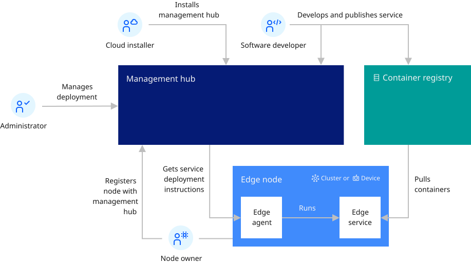

# Overview of Open Horizon

This section provides an overview of Open Horizon (OH).

## Open Horizon capabilities

Open Horizon provides you with edge computing features to help you manage and deploy workloads from a management hub cluster to edge devices and remote instances of OpenShift Container Platform or other Kubernetes-based clusters.

## Architecture

The goal of edge computing is to harness the disciplines that have been created for hybrid cloud computing to support remote operations of edge computing facilities. Open Horizon is designed for that purpose.

The deployment of Open Horizon includes the management hub that runs in an instance of OpenShift Container Platform installed in your data center. The management hub is where the management of all of your remote edge nodes (edge devices and edge clusters) occurs.

These edge nodes can be installed in remote on-premises locations to make your application workloads local to where your critical business operations physically occur, such as at your factories, warehouses, retail outlets, distribution centers, and more.

The following diagram depicts the high-level topology for a typical edge computing setup:

The Open Horizon management hub is designed specifically for edge node management to minimize deployment risks and to manage the service software lifecycle on edge nodes fully autonomously. A Cloud installer installs and manages the Open Horizon management hub components. Software developers develop and publish edge services to the management hub. Administrators define the deployment policies that control where edge services are deployed. Open Horizon handles everything else.

# Components

Open Horizon includes several components that are required for functionality. For more information about such components, please see [Components](./components.md).

## What's next

For more information about using Open Horizon and developing edge services, review the topics that are listed in Open Horizon [Welcome page](../index.md) and in the following sections:

* [Accessibility](../getting_started/accessibility.md)
* [Components](../getting_started/components.md)
* [Developer learning path](../getting_started/developer_learning_path.md)
* [Documentation conventions](../getting_started/document_conventions.md)
* [Frequently Asked Questions (FAQ)](../getting_started/faq.md)
* [Known issues and limitations](../getting_started/known_issues.md)
* [Release notes](../getting_started/release_notes.md)
