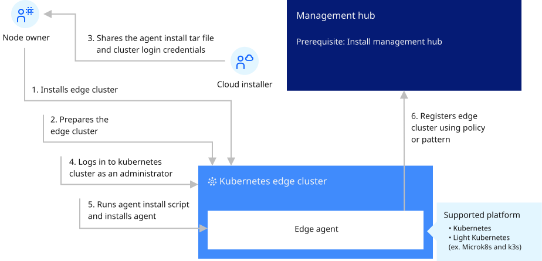

# Installing edge clusters

Open Horizon (Open Horizon) edge cluster capability helps you manage and deploy workloads from a management hub cluster to remote instances of OpenShift® Container Platform or other Kubernetes-based clusters. Edge clusters are Open Horizon edge nodes that are Kubernetes clusters. An edge cluster enables use cases at the edge, which require colocation of compute with business operations, or that require more scalability, availability, and compute capability than what can be supported by an edge device. Further, it is not uncommon for edge clusters to provide application services that are needed to support services running on edge devices due to their close proximity to edge devices. Open Horizon deploys edge services to an edge cluster, via a Kubernetes operator, enabling the same autonomous deployment mechanisms used with edge devices. The full power of Kubernetes as a container management platform is available for edge services that are deployed by Open Horizon.

The following sections describe how to install an edge cluster and configure image registries as prerequisites for installing the Open Horizon agent on the cluster.

- [Installing an OCP cluster](./install_ocp_edge_cluster.md)
- [Setting up a local image registry for a Red Hat OpenShift Container Platform edge cluster](./setting_up_ocp_image_registry.md)
- [Installing a K3s cluster](./install_k3s_edge_cluster.md)
- [Setup edge cluster local image registry for K3s](./setup_k3s_image_registry.md)
- [Installing a microk8s cluster](./install_microk8s_edge_cluster.md)
- [Setup edge cluster local image registry for MicroK8s](./setup_microk8s_image_registry.md)
- [Setting variables to use a remote image registry](./setting_remote_image_registry.md)
