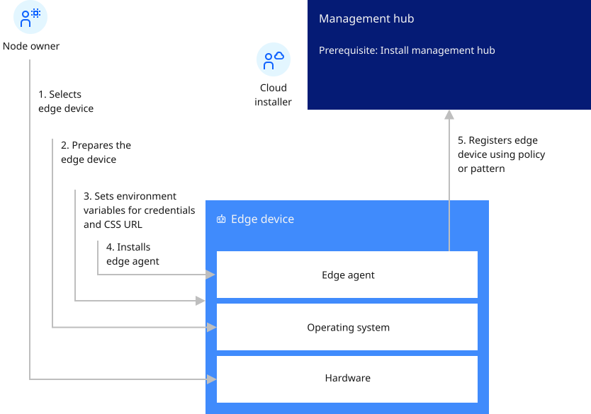

# Installing edge nodes

Edge computing places enterprise applications closer to where the data is created, and where actions need to be taken. More importantly, the negotiation, agreement, execution, and validation of management actions is autonomously carried out between the Open Horizon (Open Horizon) hub and each edge endpoint that is running a lightweight agent. This autonomous management is a new form of management that addresses the scale, variability, and rate of change of edge topologies including edge nodes: devices and clusters, edge gateways, and network edges.

Typically, edge devices have a prescriptive purpose, provide (often limited) compute capabilities, and are located near or at the data source. Edge clusters usually run workloads in remote, sometimes disconnected, locations near the data source (outside of a data center or cloud environment).

An edge device provides an entry point into enterprise or service provider core networks. Examples include smartphones, security cameras, or even an internet-connected microwave oven.

Open Horizon is available for management hub or servers, including distributed devices. See the following sections for details about how to install the Open Horizon lightweight agent on edge devices:

* [Preparing an edge device](../installing/adding_devices.md)
* [Installing the agent](../installing/registration.md)
* [Updating the agent](../installing/updating_the_agent.md)

All edge devices (edge nodes) require the Horizon agent software to be installed. The Horizon agent also depends upon [Docker&reg; ](https://www.docker.com/) software.

Focusing in on the edge device, the following diagram shows the flow of the steps you perform to set up the edge device, and what the agent does after it is started.

For more information about installing the required software for Open Horizon for nodes, see:

* [Commandline Interface (CLI)](../cli/hzn_cli.md)
* [Edge clusters](../installing/edge_clusters.md)